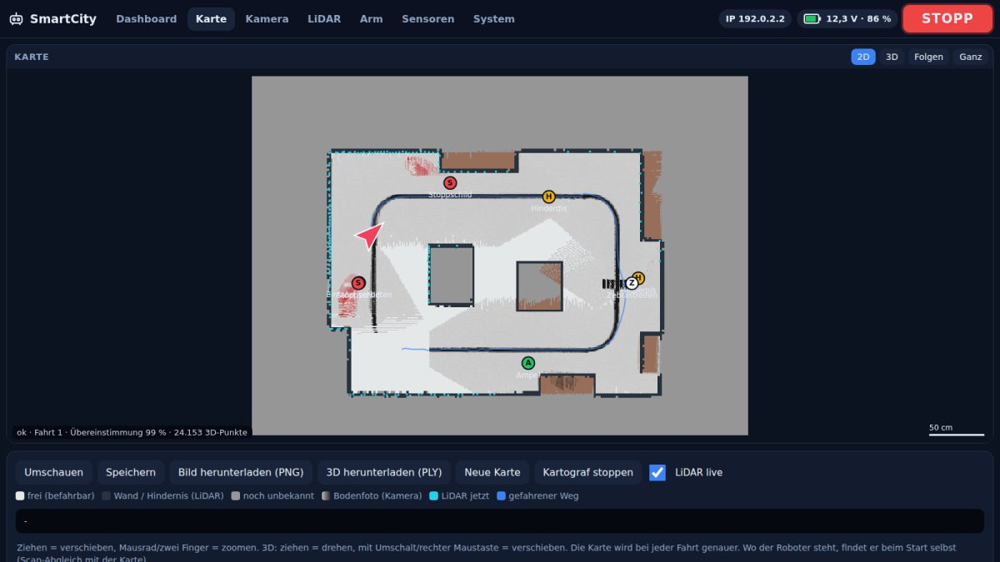
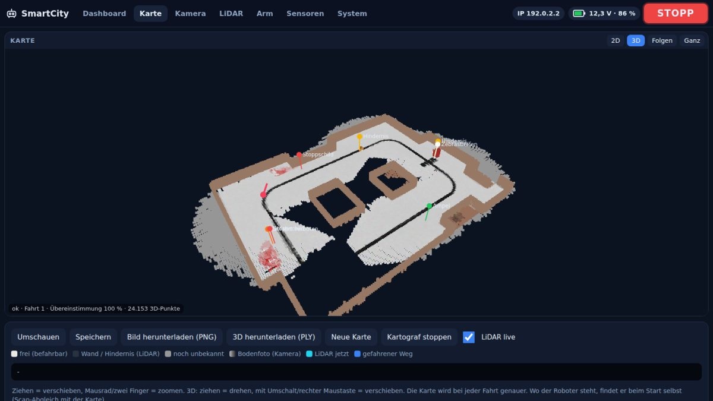
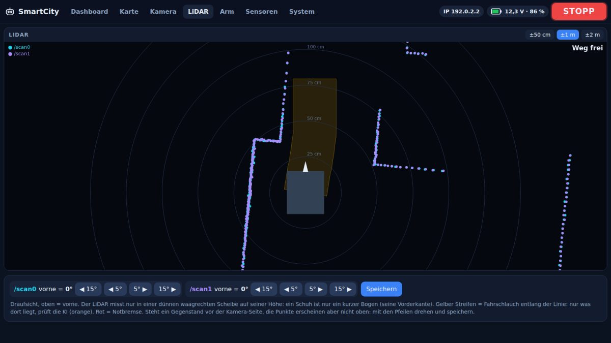
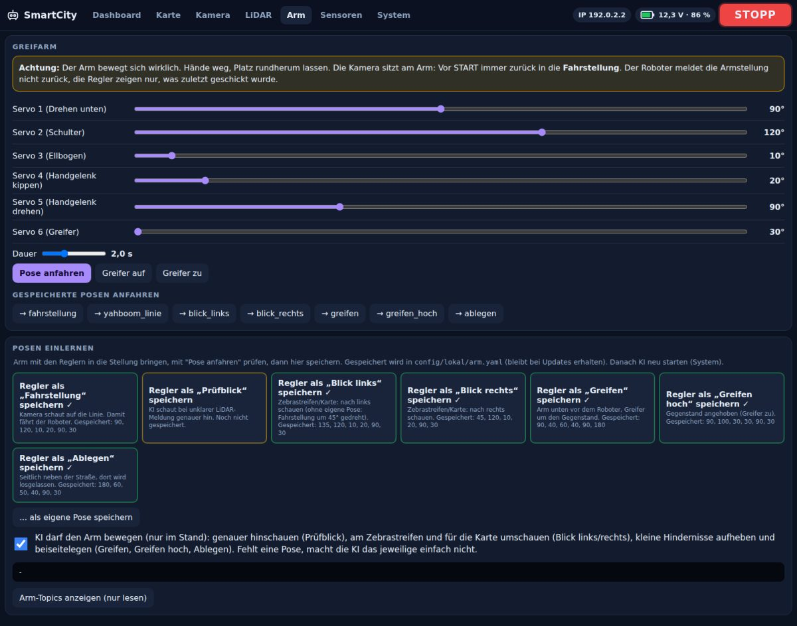

# SmartCity 2026 – Autonomes Fahren

Software für den Yahboom ROSMASTER M3 Pro (Jetson Orin, Ubuntu 22.04, ROS 2 Humble) in der SmartCity der BBS Trier.
**Repository:** https://github.com/BKoewenig/smartcity-roboter · **Bisher nur auf RM02 programmiert und getestet.**

Seit 21.10.2026 arbeiten wir im MQTT-Test-Repository. Hinweise zur lokalen Umstellung und zu historischen Verweisen: [Repository-Wechsel](docs/entwicklung/repository-wechsel.md).

Der Roboter folgt der schwarzen Linie. Eine **KI** beachtet Ampeln, Stoppschilder, Zebrastreifen, Einbahnstraßen und Hindernisse. Ein **Kartograf** baut bei jeder Fahrt eine 2D- und 3D-Karte. Bedient wird alles über das **Panel**.

👉 Ausführliche, verständliche Erklärung (zum Vortragen): **[docs/projekt.md](docs/projekt.md)**


## Installieren (einmal pro Roboter)

```bash
cd ~
git clone https://github.com/BKoewenig/smartcity-roboter.git   # Projekt herunterladen
cd ~/smartcity-roboter
scripts/installieren.sh          # Panel-Symbol ins Dock, Roboter-Name, KI-Bibliothek
```

`installieren.sh` am Bildschirm des Roboters ausführen, nicht über SSH. An Yahboom-Dateien und am Autostart ändert es nichts.

**Update:** Panel → System → „Neueste Version holen“ (oder `scripts/update.sh`). Danach das Panel neu öffnen. Eigene Einstellungen in `config/lokal/` bleiben erhalten.

## Benutzen

1. Im Dock auf **SmartCity Panel** klicken. Das startet Kamera, KI, Kartograf und das Panel.
2. **TEST**: Der Roboter zeigt alles an, fährt aber nicht. **Immer zuerst testen.**
3. **START**: Er fährt. **STOPP**: Er hält sofort an. Der STOPP-Knopf ist auf jeder Seite oben rechts.
4. Panel-Fenster schließen = Roboter hält an, alle Programme werden beendet.

**Vom Laptop:** Laptop-Zugriff ist standardmäßig **an**. Einfach die angezeigte Adresse öffnen, z. B. `http://10.0.12.62:8080`. Ausschalten: Panel → System (oder `scripts/panel.sh --kein-netz`).
**Not-Aus von außen:** `scripts/stopp.sh`
**Bei Problemen:** [Problemprotokoll](docs/problemprotokoll.md) (was schon gefunden/gelöst wurde). Panel → System → „Logs herunterladen“ (alle Protokolle als `.tar.gz`). Sie liegen in `logs/` im Projektordner, je Programm der aktuelle und der vorige Lauf (`*.alt.log`). Im Archiv stehen pro Datei höchstens die letzten 1 MB, insgesamt höchstens 8 MB; was fehlt oder gekürzt ist, steht in `logs/HINWEISE.txt`. `logs/system.log` zeigt alle 2 s Rechnerlast, Speicher, Temperatur und welches Programm am meisten rechnet.

| Karte (2D) | Karte (3D) |
|---|---|
|  |  |
| **LiDAR mit Fahrschlauch** | **Arm: Stellungen einlernen** |
|  |  |

Das Dashboard passt auch auf den 7-Zoll-Bildschirm des Roboters (1024×600) und aufs Handy.

## Einstellen (vor der ersten Fahrt)

| Was | Wo |
|---|---|
| LiDAR-Richtung „vorne“ | Panel → LiDAR, mit den Pfeilen drehen, Speichern |
| Arm: Fahrstellung, Greifer auf/zu prüfen, Kinematik prüfen | Panel → Arm, siehe [docs/greifarm.md](docs/greifarm.md) |
| Kamera-Neigung und -Höhe nachmessen | `config/lokal/roboter.yaml`, siehe [docs/linie.md](docs/linie.md) |
| Ampel-LED-Farben | Panel → System → „Ampel einstellen“ |
| Systemcheck (Name, Netz, Version, Agent) | Panel → System → „Systemcheck“; Sensoren: Panel → Sensoren |

## Was steckt wo?

| Ordner | Inhalt |
|---|---|
| `line_follower/` | Linienfolger (Draufsicht, Linien-Gedächtnis, Lenkung) |
| `ki/` | KI-Zentrale und Entscheidungsregeln |
| `kartograf/`, `lib/karte.py` | Karte 2D/3D |
| `panel/` | Bedienoberfläche (Webseite) |
| `sim/` | Simulation ohne Roboter |
| `scripts/` | Start- und Hilfsskripte (Panel, Simulation, Update, Not-Aus). Tests der Sensoren gehen über das Panel |
| `config/` | Standardeinstellungen; eigene Werte in `config/lokal/` (nicht im Repository) |
| `docs/` | Doku: [Projekt](docs/projekt.md), [KI](docs/ki.md), [Linie](docs/linie.md), [Karte](docs/karte.md), [Greifarm](docs/greifarm.md), [Roboter](docs/roboter.md), [Simulation](docs/simulation.md), [Browser](docs/browser.md) |

## Testen ohne Roboter

Die Simulation läuft auch in einer Linux-VM auf dem Laptop: Anleitung **[docs/simulation.md](docs/simulation.md)**.

```bash
scripts/simulation.sh einrichten    # einmalig: ROS 2 Humble installieren (Ubuntu 22.04)
scripts/simulation.sh               # Simulation + Panel zum Zuschauen (Kamera → „Simulation“)
scripts/simulation.sh pruefen       # komplette Fahrt, prüft alles automatisch
python3 tests/test_entscheider.py   # Regeln der KI
python3 tests/test_karte.py         # Karte
python3 tests/panel_demo.py         # Panel mit Beispieldaten, http://localhost:8099
```

## Stand

**Offen:**
- Kreuzungen und Abbiegen nach Stadtplan (K1–K8), Wegwahl, „fahr zu X“
- Abblendlicht an der LED-Leiste und Blinker beim Abbiegen
- MQTT für die Leitzentrale
- RTW-Einsatz (Sonderrechte) ist vorerst entfernt und kommt später wieder
- Alle vier Roboter gleichzeitig: Dafür braucht jeder eine eigene Domain-ID ([docs/roboter.md](docs/roboter.md))

**Bekannte Fehler / ungeprüft:**
- **Karte:** Im Simulator nachgestellte Ursachen sind behoben: falsche LiDAR-Richtung „vorne“, gespiegelter LiDAR, Lagesensor falsch herum, Odometrie ohne Geschwindigkeit, zweiter LiDAR versetzt. Welche es am echten Roboter ist, ist **nicht bewiesen** → Panel → Karte → „Messfahrt aufzeichnen“ und die Datei schicken ([docs/karte.md](docs/karte.md)).
- **Greifarm:** Die KI räumt selbst weg und lernt aus jedem Versuch (Vortraining im Simulator). Am echten Arm **noch nie gelaufen**. Die Armmaße sind aus einem öffentlichen Modell bzw. der URDF. Vor der ersten Fahrt Greifer auf/zu prüfen ([docs/greifarm.md](docs/greifarm.md)).
- **Kamerahöhe:** Laut Robotermodell sitzt die Kamera in Fahrstellung bei ca. 31 cm, eingestellt sind 22 cm. Bitte nachmessen (betrifft Linie, Karte, Tiefe).
- **Linienfolger:** Pendeln bei höherem Tempo ist in der Simulation behoben. Am Roboter ungeprüft, die Verzögerungswerte sind geschätzt ([docs/linie.md](docs/linie.md)).
- Teilweise KI-Aussetzer. Die KI rechnet jetzt auf der Grafikkarte, wenn möglich. Ist sie trotzdem überlastet (wenige Bilder pro Sekunde), hält der Roboter lieber an, statt etwas zu übersehen.
- Die Objekterkennung ist teilweise fehlerhaft, Ampeln werden noch nicht sauber erkannt.

Alles Neue ist zuerst in der Simulation getestet. Gerätetests auf RM02 laufen.
