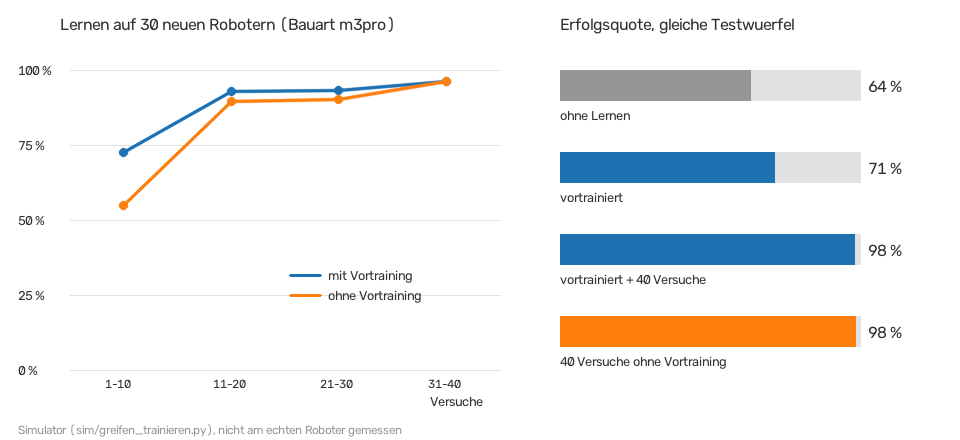

# Greifarm

## Auf RM02 geprüft

- `/arm6_joints` gibt es, Typ `arm_msgs/msg/ArmJoints` mit `joint1`–`joint6` und `time` (alles `int16`). Subscriber = Motorboard (über den micro-ROS-Agent). Prüfen: Panel → Arm → „Arm-Topics anzeigen“ (nur lesen).
- Die Gamepad-Steuerung (`yahboomcar_ctrl/yahboom_joy_M3Pro.py`, startet automatisch) sendet ebenfalls auf `/arm6_joints` und `/arm_joint`. **Gamepad und Panel nicht gleichzeitig am Arm benutzen.**
- Startstellung der Gamepad-Steuerung: **90, 120, 10, 20, 90, 0**. Damit lief unser Linienfolger → in `config/arm.yaml` als `fahrstellung` (Greifer 30 statt 0).
- Yahbooms eigener Linienfolger (`largemodel_arm/follow_line.py`): **90, 90, 12, 20, 90, 0** → als `yahboom_linie`. Achtung: Dort wird Servo 1 als `180 - Wert` geschickt (bei 90 egal).
- Beim Greifer waren „zugreifen“ und „öffnen“ vertauscht (siehe unten, jetzt nach Yahboom eingestellt).

## Was in Yahbooms Unterlagen steht

Quelle: [Yahboom ROSMASTER M3 Pro, Kursunterlagen](https://github.com/YahboomTechnology/ROSMASTER-M3PRO) (Kapitel „Robotic Arm and 3D Space Gripping“, „Configuration and Operation Guide“).

| Was | Wert |
|---|---|
| Alle Servos | `/arm6_joints` (`arm_msgs/msg/ArmJoints`): `joint1`…`joint6` in ganzen Grad, `time` in ms |
| Ein Servo | `/arm_joint` (`arm_msgs/msg/ArmJoint`): `id`, `joint`, `time` |
| Winkel | Servo **90** = Glied zeigt gerade nach oben. Alle auf 90 = Arm senkrecht |
| Greifer (Servo 6) | **30 = offen**, 120–130 = zugegriffen, 180 = ganz zu (größer = fester). Eine andere Yahboom-Anleitung sagt das Gegenteil → **am Roboter prüfen** |
| Kinematik | Dienst `/get_kinemarics` (`arm_interface/srv/ArmKinemarics`), Programm `ros2 run arm_kin kin_srv`. Rechnet mit dem echten Robotermodell (URDF): Zielpunkt → Servowinkel (`ik`) und Servowinkel → Punkt (`fk`) |
| Kamera | sitzt am Arm-Ende („eye-in-hand“). Umrechnung Kamerapunkt → Arm mit einer festen Matrix und der Vorwärtsrechnung |
| Kalibrierung | 1. Mittelstellung (`calibrate_arm.py`), 2. Versatz mit einem 4-cm-Würfel (`arm_offset`) → `~/yahboomcar_ws/src/arm_kin/param/offset_value.yaml` |

**Vorsicht bei Servo 1:** Yahboom schickt Servo 1 als `180 - joint1` aus der Kinematik. Das übernimmt unser Code genauso.

## Hindernis wegräumen: so rechnet die KI die Armbewegung aus

Es gibt **keine eingelernten Greif-Posen**. Die KI misst das Hindernis, rechnet aus, wie die Servos stehen müssen, und **lernt aus jedem Versuch dazu** (Ablauf: [ki.md](ki.md), „Hindernis wegräumen“).

1. Die Tiefenkamera liefert, wo das Hindernis liegt (vorne, seitlich, Breite, Höhe; dazu Bildpunkt und Tiefe).
2. **Zielpunkt ausrechnen** (inverse Kinematik = „rückwärts rechnen“: Wo soll der Greifer hin → wie müssen die Servos stehen?). Die KI nimmt, was da ist:
   - **Yahbooms Kinematik-Dienst** (`/get_kinemarics`), wenn er läuft. Er rechnet mit dem echten Robotermodell (wie Yahbooms `grasp_desktop.py`: Kamerapunkt → Arm-Ende → `base_link`, plus Versatz aus `offset_value.yaml`).
   - sonst die **eigene Rechnung** (`lib/arm.py`, `Kinematik`). Die Maße holt sie sich so (das Erste, was es gibt):
     1. selbst nachgemessen in `config/lokal/arm.yaml` unter `geometrie:`,
     2. **Yahbooms Robotermodell (URDF)** auf dem Roboter (`lib/urdf.py` sucht das Paket `yahboom_M3Pro_description` über `ros2 pkg prefix` und in `~/yahboomcar_ws/src/…`, liest `.urdf` und `.xacro` ohne Zusatzpakete),
     3. Standardmaße in `config/arm.yaml` (aus einem öffentlichen M3-Pro-Modell, Maße laut Autor aus Yahbooms CAD: Schulter 21,8 cm hoch, Oberarm/Unterarm je 8,3 cm).
3. **Gelernte Korrektur dazu** (siehe nächster Abschnitt). Der Greifer zielt auf *Zielpunkt + Korrektur*.
4. **Reicht der Arm nicht hin?** Mit den Standardmaßen erreicht der Arm den Boden nur bis ca. 22 cm vor der Robotermitte. Dann rechnet die KI aus, wie viel näher sie muss (höchstens 12 cm), fährt **blind und langsam** (3 cm/s) heran, greift und fährt danach wieder zurück, damit die Kamera den Platz prüfen kann.
5. **Langsam:** Kein Servo dreht schneller als 60 Grad pro Sekunde. Winkel außerhalb der Servo-Grenzen werden abgelehnt.
6. Geht es trotzdem nicht, bewegt sich nichts, und im Panel steht der Grund (z. B. „Arm erreicht es nicht: …“).

**Simulation:** Die KI plant mit den Maßen aus `sim/arm_sim.yaml` (`geometrie`). Der Simulator rechnet aber mit einem etwas anders gebauten Arm (`geometrie_simulator`: andere Längen, Servo-Nullpunkte 1–2° daneben, Arm hängt 2,9° durch). Ob gegriffen ist, rechnet er aus den Servowinkeln nach (`lib/greifen.py`, `trifft`: Greifermitte innerhalb der Greiferöffnung um den Würfel, über dem Boden, unter der Oberkante). Wie am echten Roboter muss die KI den Unterschied also selbst ausgleichen.

## Greifen lernen (lib/greifen.py)

**Warum?** Maße, Servos und Kamera stimmen nie ganz genau. Schon 2° an einem Servo sind am Greifer fast 1 cm. Darum greift der Arm etwas daneben, auch wenn die Rechnung stimmt.

**Wie lernt er?** Fachbegriff: *Reinforcement Learning* = Lernen durch Ausprobieren und Belohnung. Hier eine kleine, nachvollziehbare Form („Bayes-Lernen mit Thompson-Sampling“):

- Er hat eine Liste mit ca. 2600 **Vermutungen**, welche Korrektur richtig ist (Gitter: −4 … +4 cm nach vorne/seitlich, −2 … +2 cm hoch, alle 5 mm). Jede hat eine Wahrscheinlichkeit.
- **Vorher** (Vorwissen aus dem Vortraining): Vermutungen nahe am Vortraining sind wahrscheinlich.
- **Ausprobieren:** Für jeden Versuch zieht er zufällig eine Vermutung, wahrscheinliche öfter. Am Anfang probiert er also verschiedene Korrekturen, später fast immer die beste. Nie außerhalb des Gitters (sicher begrenzt).
- **Gewinner bleibt:** Hat der letzte Versuch geklappt, nimmt er in 70 % der Fälle genau dieselbe Korrektur nochmal (`WIEDERHOLEN`), sonst zieht er neu. Grund: In der ROS-Simulation hatte er nach einem Erfolg viermal hintereinander etwas Neues ausprobiert und verfehlt. Messung an 15 neuen Robotern (vortrainiert, Erfolg je 10 Versuche): M3 Pro 67 → 91 → 93 → 98 % vorher, 69 → 95 → 91 → 97 % nachher; Simulator-Arm 70 → 89 → 97 → 99 % vorher, 80 → 90 → 96 → 94 % nachher. Besser am Anfang, später gleich (die Unterschiede dort liegen im Zufall von nur 15 Robotern).
- **Versuche:** Bis zu 4 Versuche je Hindernis, jeder Fehlversuch wird gelernt. Danach wartet er.
- **Belohnung:** Nach dem Wegräumen prüft die Kamera den Weg. Frei = Erfolg, liegt noch da = Misserfolg.
- **Lernen** (Satz von Bayes): Erfolg → alle Vermutungen, bei denen dieser Versuch auch geklappt hätte, werden wahrscheinlicher. Misserfolg → genau diese werden unwahrscheinlicher. Ein einzelner Fehlversuch zählt nicht voll (kann auch Pech sein). Ältere Versuche zählen etwas weniger.
- Wie die Korrektur von der Lage des Würfels abhängt (weiter vorne, seitlich, höher), lernt das Vortraining (Ausgleichsgerade = lineare Regression). Auf dem Roboter lernt er die Grundkorrektur.

Jeder Versuch erscheint als Ereignis, z. B. „Greifversuch 7: Erfolg, Erfolgsquote 86 % (letzte 7), Korrektur jetzt +1,2 / −0,4 / +0,3 cm“.

**Vortraining im Simulator** (`python3 sim/greifen_trainieren.py`, ca. 10 Minuten, `--schnell` ca. 2 Minuten, `--png datei.png` zeichnet die Lernkurve):

- Schnelle Übungswelt ohne ROS (`sim/greifen_welt.py`): echte Tiefenbilder aus `sim/welt.py`, ausgewertet mit derselben Rechnung wie die KI (`lib/tiefe.py`), geplant mit derselben Rechnung (`lib/greifen.py`, `lib/arm.py`).
- **Domain Randomization:** Jeder Übungsroboter ist etwas anders gebaut: Armlängen (±4–10 mm), Schulter (±8 mm), Servo-Nullpunkte (±2,5°), Durchhängen (0–3°), Servo-Spiel, Kamera (Höhe ±1,2 cm, Neigung ±2,5°, Lage, Drehung, Blickwinkel), Tiefenrauschen (2–6 mm) und Maßstabsfehler, Würfelgröße (3–5 cm) und Lage. Der Planer kennt davon nichts.
- Im Simulator weiß man genau, wo der Greifer wirklich landet. Daraus rechnet das Vortraining die ideale Korrektur je Würfel und macht eine Ausgleichsrechnung über alle Übungsroboter. Ergebnis: was bei allen gleich danebengeht (Mittel) und wie verschieden die Roboter sind (so breit sucht er auf einem neuen Roboter anfangs).
- Zwei Modelle in `models/greifen.json`: `eigene` (echter Roboter, Maße wie `config/arm.yaml`) und `sim` (ROS-Simulator). Mit Yahbooms Dienst lernt er ein drittes Modell `yahboom` (ohne Vortraining, startet bei 0).

**Wo liegt was?**

| Datei | Was | Im Repository? |
|---|---|---|
| `models/greifen.json` | vortrainiert im Simulator | ja |
| `config/lokal/greifen.json` | auf diesem Roboter weitergelernt (die letzten 150 Versuche) | nein, bleibt bei Updates |

Panel → Arm → „Greifen lernen“ zeigt den Lernstand. **„Gelerntes zurücksetzen“** löscht `config/lokal/greifen.json`, dann gilt wieder das Vortraining.

### Ergebnisse des Lernens

Gemessen mit `python3 sim/greifen_trainieren.py` (Übungswelt, **nicht am echten Roboter**). Geprüft an **neuen** Zufallsrobotern, die das Vortraining nicht kannte (andere Zufallszahlen). Je Roboter dieselben 20 Testwürfel für alle Varianten, ohne Ausprobieren.

| Erfolgsquote | Bauart M3 Pro (30 neue Roboter) | Bauart Simulator (15 neue Roboter) |
|---|---|---|
| a) ohne Lernen (nur Kinematik) | 63,5 % | 55,7 % |
| b) vortrainiert, ohne weiterzulernen | 71,3 % | 73,0 % |
| c) vortrainiert + 40 Versuche auf dem Roboter weitergelernt | **98,2 %** | **99,7 %** |
| d) zum Vergleich: 40 Versuche gelernt, ohne Vortraining | 98,3 % | 99,7 % |

Lernkurve auf den neuen Robotern (Erfolg je 10 Versuche, *mit* Ausprobieren):

| Versuche | 1–10 | 11–20 | 21–30 | 31–40 |
|---|---|---|---|---|
| M3 Pro, mit Vortraining | 72 % | 93 % | 93 % | 96 % |
| M3 Pro, ohne Vortraining | 55 % | 90 % | 90 % | 96 % |
| Simulator-Arm, mit Vortraining | 69 % | 90 % | 96 % | 96 % |
| Simulator-Arm, ohne Vortraining | 58 % | 81 % | 89 % | 87 % |



**Was heißt das (ehrlich)?**

- Das **Weiterlernen auf dem Roboter bringt am meisten** (von 64 % auf 98 % nach 40 Versuchen).
- Das **Vortraining hilft vor allem am Anfang** (erste 10 Versuche: 72 % statt 55 %), weil es weiß, was bei allen Robotern gleich danebengeht (z. B. Kamera misst die Vorderseite, Arm hängt durch). Nach 40 Versuchen ist der Vorsprung weg: Jeder Roboter ist anders, das muss er selbst lernen.
- Für einzelne Roboter kann das Vortraining auch schlechter sein als gar keine Korrektur (Beispiel-Roboter Nr. 1: 80 % ohne, 40 % vortrainiert, nach 40 Versuchen 100 %).
- Die Lernkurve des Vortrainings selbst (Modell aus den ersten n Übungsrobotern, geprüft an 8 Robotern) steigt von 68 % auf ca. 75–78 % und schwankt dann (Messung mit nur 120 Würfeln).
- **Im ROS-Simulator** (`sim/pruefen.py`, simulierter Arm absichtlich anders als geplant): ohne Lernen griffe er dort fast immer daneben (2,5 % in der Übungswelt), vortrainiert 42,5 %. In der geprüften Fahrt ging der 1. Greifversuch daneben (Greifer stieß auf den Boden, der Arm hängt durch), die KI hob die Korrektur an, der 2. Versuch klappte.


## Sicherheitsregeln, wenn die KI den Arm bewegt

`ki_darf_arm_bewegen` ist jetzt **standardmäßig an** (`config/arm.yaml`). Ausschalten: Panel → Arm → Schalter „KI darf den Arm bewegen“. Das gilt nach ca. 2 s, ohne Neustart.

- nur im **Stand** (während der Arm sich bewegt, steht der Roboter) und nur, solange das Fahrprogramm **fährt** (START). Im TEST und nach STOPP nie; ein laufender Ablauf wird abgebrochen.
- **nie bei Lebewesen und Fahrzeugen:** Sieht die Kamera beim Anschauen eine Person, ein Tier oder ein Fahrzeug, fasst er nichts an. Taucht so etwas während des Greifens auf, bricht er ab, und der Arm fährt zurück.
- nichts anfassen kurz nach einem Zebrastreifen, am Straßenrand oder wenn es zu groß ist.
- **Servo-Grenzen** werden geprüft, Bewegungen höchstens 60°/s.
- **Notbremse** (LiDAR unter 12 cm): Der Ablauf pausiert. Dauert sie länger als 5 s, bricht er ab. Der Arm fährt erst zurück, wenn die Notbremse vorbei ist.
- **Warum tut er nichts?** Steht immer im Ereignis und im Panel (Arm → „KI und Arm“), z. B. „Arm für die KI ausgeschaltet“, „Fahrprogramm fährt nicht (nur TEST)“, „Arm erreicht es nicht: …“, „Hindernis ist Person → nicht anfassen“. Beim Start meldet die KI, ob sie den Arm bewegen darf und mit welcher Kinematik sie rechnet.

## Vor dem ersten echten Versuch (in dieser Reihenfolge)

1. **Greifer prüfen:** Panel → Arm → „Greifer auf“ / „Greifer zu“. Ist es falsch herum, in `config/lokal/arm.yaml` eintragen:
   ```yaml
   greifer_auf: 130
   greifer_zu: 30
   ```
2. **Yahbooms Arm-Kalibrierung** machen (Mittelstellung und Versatz, siehe oben). Ohne sie greift die Kinematik weiter daneben (das Lernen gleicht nur ein paar Zentimeter aus).
3. **Kinematik prüfen:** Panel → Arm → „Kinematik prüfen“. Das bewegt nichts. Läuft Yahbooms Dienst nicht, rechnet die KI selbst (Maße aus der URDF oder Standard). Was sie nimmt, steht beim Start im Ereignis.
4. **Richtung von Servo 1 prüfen** (`servo1_links` in `config/arm.yaml`): Arm mit Servo 1 auf 120 schicken. Dreht er nach links, stimmt `1`, sonst `-1` in `config/lokal/arm.yaml` eintragen.
5. Ersten Versuch mit kleinem Tempo machen, eine Hand am STOPP. Würfel mittig auf die Linie legen. Die ersten Versuche gehen eher daneben; nach 10–20 Versuchen sollte die Erfolgsquote im Panel steigen.

**Ungeprüft auf dem Roboter:** Kinematik-Dienst, Umrechnung Kamerapunkt → Arm, Greifer-Werte, die Standardmaße und das Lesen von Yahbooms URDF (getestet nur mit einem öffentlichen Nachbau), die Richtung von Servo 1, die Greiferöffnung (8,5 cm geschätzt), ob der Arm in Fahrstellung so steht, wie die eigene Rechnung denkt, und **das ganze Lernen**. Es wurde nur in der Simulation gemessen. Auf dem Roboter kann es Fehler geben, die die Simulation nicht kennt (z. B. Würfel rutscht aus dem Greifer, Kamera sieht den Würfel aus der Nähe nicht). Die Kontrolle „Weg frei?“ ist die einzige Belohnung: Schiebt der Arm den Würfel nur zur Seite aus dem Bild, zählt das auch als Erfolg. Der LiDAR könnte den Arm sehen, wenn er vorne bis zum Boden greift. Dann greift die Notbremse (unter 12 cm).

## Im Panel (Seite "Arm")

- 6 Schieberegler, "Pose anfahren", Greifer auf/zu, Dauer der Bewegung.
- Gesperrt, solange das Fahrprogramm läuft (die Kamera sitzt am Arm).
- Schalter „KI darf den Arm bewegen“ (Standard an, gilt sofort) und Abschnitt **„Greifen lernen“**: was die KI gerade darf und warum nicht, welche Kinematik sie nimmt, Versuche, Erfolgsquote, gelernte Korrektur, Knopf „Gelerntes zurücksetzen“.
- Werte außerhalb der Bereiche werden abgelehnt, nicht gekürzt.
- **Posen einlernen**: Regler einstellen, mit "Pose anfahren" prüfen, dann den passenden Knopf drücken. Gespeichert wird in `config/lokal/arm.yaml`. Die Datei ist nicht im Repository, bleibt also bei Updates erhalten. Standardwerte stehen in `config/arm.yaml`. Danach die KI neu starten (System).

| Pose | Wofür | Hinweis |
|---|---|---|
| **fahrstellung** | Linienfolgen. **Als Erstes!** | Startstellung der Gamepad-Steuerung ist voreingestellt. Kameramaße danach nachmessen (`docs/linie.md`) |
| blick_links / blick_rechts | Zebrastreifen und Karte: umschauen | ohne eigene Pose: Fahrstellung mit Servo 1 um ±45° gedreht. **Richtung ungeprüft**: zeigt "links" nach rechts, beide neu einlernen |

Alle Werte aus `ki/entscheider.py` (`STANDARD`) lassen sich einstellen, z. B. `greif_vor` (wie weit vor der Robotermitte er zum Greifen hält). Eintragen in `config/lokal/roboter.yaml`:

```yaml
ki_zentrale:
  ros__parameters:
    greif_vor: 0.24
```

Danach die KI neu starten.
