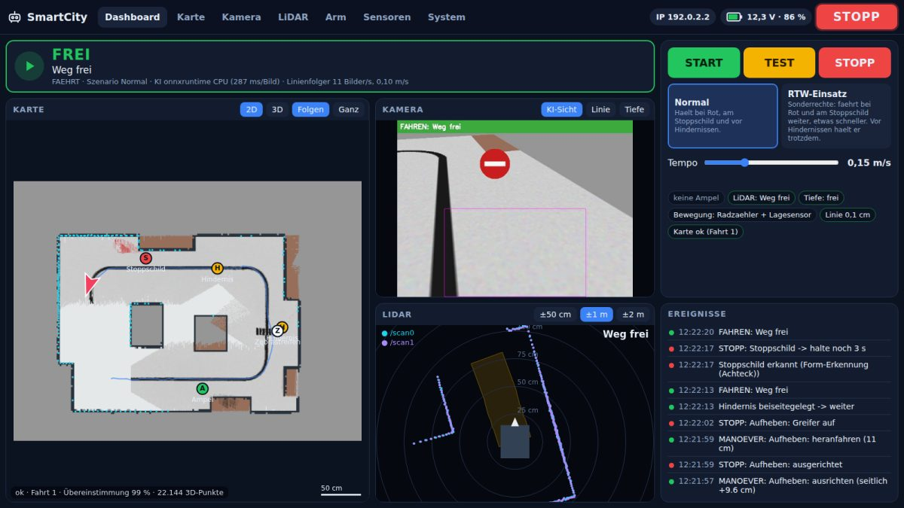

# Projekt SmartCity 2026 – Autonomes Fahren

**Team Autonomes Fahren, BBS Trier · Stand: 02.10.2026**
Repository: https://github.com/BKoewenig/smartcity-roboter

Diese Datei erklärt, was wir gebaut haben und wie es funktioniert.  Technische Details stehen in den anderen Dateien in `docs/`.

---

## 1. Worum geht es?

In der SmartCity (einer Modellstadt auf einer Matte) sollen vier Roboter selbstständig durch die Straßen fahren. Sie sollen Verkehrsregeln beachten, sich nicht gegenseitig rammen und nichts umwerfen.

**Bisher wurde nur RM02 programmiert und getestet.** RM01, RM03 und RM04 sollen später denselben Stand bekommen.

Unser Roboter ist ein **Yahboom ROSMASTER M3 Pro**:

| Teil | Wofür |
|---|---|
| **Jetson Orin** (kleiner Computer mit Grafikchip) | rechnet alles, läuft mit Ubuntu Linux |
| **Mecanum-Räder** | Räder mit schrägen Rollen, damit kann er auch seitwärts fahren |
| **Kamera mit Tiefenmessung** (am Greifarm) | sieht Linie, Ampeln, Schilder und misst Abstände |
| **2 LiDAR** | Laser, der sich dreht und rundherum Abstände misst |
| **Lagesensor (IMU)** und **Radzähler** | merken, wie er sich dreht und wie weit er fährt |
| **Greifarm** mit 6 Motoren | kann Dinge greifen und die Kamera schwenken |

Die Programme laufen auf **ROS 2** („Robot Operating System“). Das ist kein Betriebssystem, sondern ein Baukasten: Jedes Programm (Node) schickt Nachrichten über benannte Kanäle (Topics), z. B. `/cmd_vel` für Fahrbefehle oder `/scan0` für LiDAR-Daten. Andere Programme können diese Kanäle abonnieren.

---

## 2. Das Gesamtbild

```
  Kamera ─┐
  LiDAR ──┼──► KI-Zentrale ──► "fahren / langsam / stopp" ──► Linienfolger ──► Motoren
  Tiefe ──┘        │                                              ▲
                   └──► Greifarm (nur wenn erlaubt)               │ lenkt nach der Linie
                                                                  │
  alle Sensoren ─────► Kartograf ──► Karte (2D + 3D)              │
                                                                  │
  Panel (Webseite) ◄── zeigt alles an, START / TEST / STOPP ──────┘
```

Es gibt vier Hauptprogramme:

1. **Linienfolger**: hält den Roboter auf der schwarzen Linie.
2. **KI-Zentrale**: entscheidet, ob er fahren darf (Ampel, Schild, Hindernis …).
3. **Kartograf**: zeichnet beim Fahren eine Karte.
4. **Panel**: Bedienoberfläche im Browser oder im eigenen Fenster.

---

## 3. Wie folgt er der Linie?

Die Kamera schaut schräg nach unten. Im Kamerabild sieht eine Kurve deshalb flacher aus, als sie ist. Darum:

1. **Draufsicht berechnen**: Das Bild wird so umgerechnet, als würde man von oben auf den Boden schauen. Dann ist jeder Pixel ein echtes Stück Boden (4 mm).
2. **Linie finden**: Er sucht die dunkle Fläche, die am besten zur bisherigen Linie passt.
3. **Gedächtnis**: Er merkt sich die Linienpunkte und rechnet seine eigene Bewegung mit. So weiß er auch, wo die Linie **unter** ihm liegt, wo die Kamera nichts sieht.
4. **Lenken**: Er rechnet aus, wie stark die Kurve ist, und lenkt vorher ein. In Kurven fährt er langsamer.

**Problem aus dem Test:** Ist der Computer ausgelastet, kommen die Kamerabilder zu spät an. Dann lenkt er nach einem alten Bild. Lösung: Jedes Bild hat einen Zeitstempel. Er trägt die Linie dort ein, wo er beim **Fotografieren** stand. Ist ein Bild zu alt, wird er langsamer oder hält an.

**Sicherheit:** Fahrbefehle gehen 20× pro Sekunde raus. Kommt 0,3 s lang kein Befehl, stoppt das Motorboard von selbst (Watchdog = Aufpasser-Zeitschaltung).

---

## 4. Wie entscheidet die KI?

Die KI-Zentrale bekommt alle Sinne und entscheidet 10× pro Sekunde. Die Regeln stehen in einer festen Reihenfolge. Die wichtigste zuerst:

| Situation | Entscheidung |
|---|---|
| LiDAR: etwas näher als 12 cm | **sofort STOPP** (Notbremse, ohne Nachdenken) |
| Sensor fällt aus | STOPP (wer nichts sieht, fährt nicht) |
| Etwas liegt im Fahrweg | STOPP, genau hinschauen, mit dem Arm wegräumen, **prüfen, ob frei**, dann weiter |
| Person, Auto, Tier im Weg | STOPP |
| Zebrastreifen | anhalten, umschauen, erst weiter, wenn niemand kommt |
| „Einfahrt verboten“ | nicht hineinfahren (wenden) |
| Ampel rot oder gelb | warten, bis sie grün ist |
| Stoppschild | 3 Sekunden halten |

**Fahrschlauch:** Der LiDAR sieht auch Häuser neben der Straße. Darum prüft die KI nur den Streifen, den der Roboter wirklich überfährt, und zwar entlang der Linie, auch in Kurven.

**Die Augen der KI:**
- **YOLO** ist ein fertiges KI-Modell (neuronales Netz), das 80 Dinge erkennt, z. B. Person, Auto, Ampel und Stoppschild. Es wurde mit echten Fotos trainiert, darum erkennt es Modellfiguren nur teilweise.
- **Zusätzlich** gibt es eigene Erkennungen:
  - leuchtende Ampel-LEDs,
  - achteckige rote Schilder (Stoppschild),
  - roter Kreis mit weißem Balken (Einfahrt verboten),
  - Streifenmuster (Zebrastreifen).
- Die **Tiefenkamera** erkennt alles, was aus dem Boden ragt. Damit sieht sie auch einen kleinen Holzwürfel, der zu flach für den LiDAR ist.

**Hindernis wegräumen:** Melden LiDAR oder Tiefenkamera etwas im Fahrweg, hält der Roboter an und die Kamera schaut genau hin. Sie wartet dabei auf mehrere Bilder, nicht nur auf eine feste Zeit. Ist die KI gerade langsam, dauert es eben etwas länger. Danach weiß sie, wo das Ding liegt, wie breit und wie hoch es ist. Dann **rechnet** sie aus, wie die Servos stehen müssen, damit der Greifer genau dort ist (**inverse Kinematik**: vom Zielpunkt rückwärts auf die Gelenkwinkel). Es gibt dafür keine fest eingelernten Stellungen. Nach dem Ablegen schaut die Kamera wieder nach vorne und **prüft**, ob der Weg wirklich frei ist. Erst dann fährt er weiter. Liegt es noch da, lernt er aus dem Fehlversuch und versucht es erneut, höchstens 4-mal, dann wartet er. Personen, Tiere und Fahrzeuge fasst er nie an.

---

## 5. Die Karte

Der Kartograf baut bei jeder Fahrt eine Karte und verbessert sie bei jeder weiteren Fahrt.

| Schicht | aus welchem Sensor |
|---|---|
| Wände und Hindernisse (2D) | LiDAR |
| Foto vom Boden mit Linien und Zebrastreifen | Kamera |
| 3D-Punkte von allem, was aus dem Boden ragt | Tiefenkamera |
| Ampeln, Schilder, Zebrastreifen als Markierung | KI |

**Wo bin ich?**
1. **Mitrechnen** mit Radzählern und Lagesensor. Das wird mit der Zeit ungenau, ähnlich wie Schritte zählen mit geschlossenen Augen.
2. **Scan-Abgleich**: Der aktuelle LiDAR-Scan wird so lange verschoben und gedreht, bis er auf die bisherige Karte passt. Wie ein Puzzleteil, das man einpasst.
3. **Neue Fahrt**: Er sucht seine Position selbst in der alten Karte.

**Zwei LiDARs:** Der M3 Pro hat zwei LiDARs, diagonal an zwei Ecken. Früher hat der Kartograf so getan, als säßen beide in der Robotermitte. Dann passen die zwei Scans nicht genau zusammen, und die Karte dreht sich mit jeder Runde ein paar Grad weiter. In der Simulation nachgestellt: von 2,7° in Runde 1 auf 5,2° in Runde 5. Jetzt baut der erste LiDAR die Karte. Wo der zweite **genau** sitzt, lernt der Kartograf selbst, indem er dessen Scans auf die Karte schiebt. Erst danach zählen seine Punkte mit. Mit der Korrektur bleibt der Fehler in der Simulation über 5 Runden bei etwa 1°.

In der Simulation liegt er im Mittel 1,5 cm daneben. Die Karte kann man als Bild (PNG) und als 3D-Modell (PLY) herunterladen.

---

## 6. Das Panel

Das Panel ist eine Webseite, die auf dem Roboter läuft. Man öffnet sie mit einem Klick im Dock oder vom Laptop über die IP-Adresse des Roboters.



| Seite | Inhalt |
|---|---|
| Dashboard | alles auf einen Blick: Entscheidung der KI, Karte, Kamera, LiDAR, Knöpfe, Ereignisse |
| Karte | 2D/3D, verschieben, zoomen, herunterladen |
| Kamera / LiDAR | groß, LiDAR-Richtung einstellen |
| Arm | Servos einzeln bewegen, Stellungen („Posen“) speichern |
| Sensoren / System | Akku, Sensoren mit Messrate, IP-Adresse, Update |

**Technik dahinter:**
- Das Panel ist ein kleiner **HTTP-Server in Python** (nur Standardbibliothek). Die Seite ist **HTML + JavaScript** ohne Internet-Abhängigkeit.
- Die Seite fragt den Status 2–3× pro Sekunde als **JSON** ab (`/api/status`).
- **Kamerabilder:** Das nächste Bild wird erst geholt, wenn das vorige angekommen ist (Pull statt Stream). Ein Videostrom würde sich im WLAN aufstauen.
- **Zugriff vom Laptop** ist standardmäßig **an** (so ist es bequemer zum Arbeiten). Solange er an ist, kann jeder im Netz, der die Adresse kennt, den Roboter steuern. Ausschalten am Roboter: Panel → System.
- **Die IP-Adresse** wird bei jedem Aufruf neu ermittelt, weil sie sich mit den VLANs ändert.

---

## 7. Simulation

Wir haben nicht immer einen Roboter. Darum gibt es eine Simulation: eine kleine 2D-Welt mit Rundkurs, Ampel, Zebrastreifen samt Fußgänger, Holzwürfel, Stoppschild und Einbahnstraße. Der Simulator erzeugt Kamerabilder, Tiefenbilder und LiDAR-Daten, die sich für die Programme wie echte Sensoren verhalten.

`scripts/simulation.sh pruefen` fährt gut 2 Minuten und prüft automatisch, ob alles stimmt: Linie genau, nicht über Rot, am Zebrastreifen gewartet, Würfel weggeräumt usw. Mit `scripts/simulation.sh` läuft sie mit dem Panel, dort zeigt Kamera → „Simulation“ die Welt von oben. Sie läuft auch in einer Linux-VM auf dem Laptop ([simulation.md](simulation.md)).

Die Simulation nutzt eine eigene **Domain-ID** (77). Das ist die Kanalnummer, auf der ROS-Programme miteinander reden. Die Roboter nutzen 30, so steuert die Simulation nie aus Versehen einen echten Roboter.

**Aber:** Die Simulation ist nicht die Wirklichkeit. Im echten Test kamen Probleme vor, die die Simulation nicht hatte, z. B. verspätete Bilder.

---

## 8. Wie wir gearbeitet haben

- **Git und GitHub**: Jede Änderung ist ein **Commit** mit deutscher Beschreibung. Neue Funktionen kommen über einen **Pull Request** in den Hauptzweig `main`. Auf dem Roboter holt `scripts/update.sh` die neueste Version.
- **Eigene Einstellungen** (Arm-Stellungen, LiDAR-Winkel) liegen in `config/lokal/` und **nicht** im Repository. So überschreibt ein Update sie nicht.
- **Sicherheitsregeln:**
  - Neue Fahrprogramme zuerst im TEST-Modus ausprobieren.
  - Ein Not-Aus ist immer möglich (STOPP-Knopf, `scripts/stopp.sh`).
  - Nach STOPP bewegt die KI den Arm nicht.
  - Passwörter kommen nie ins Repository.
- **Tests:** automatische Tests (`tests/`), die Simulation und dann der echte Roboter.

### Was bisher passiert ist (Kurzfassung)

| Schritt | Ergebnis |
|---|---|
| 1. Grundlagen | Linienfolger, LiDAR-Notbremse, Ampel-LED-Erkennung, Skripte |
| 2. KI-Zentrale + Panel | KI entscheidet mit Grund, Panel mit großen Knöpfen, Arm-Steuerung, Simulation |
| 3. Arm | Yahboom-Stellungen übernommen, Arm per Panel steuerbar |
| 4. Großes Update | genauere Kurven, Zebrastreifen, Einbahnstraße, Würfel aufheben, Karte 2D/3D, Dashboard |
| 5. Fixes nach Tests | LiDAR-Aussetzer, Kurve als „Stuhl“ erkannt, Ampel als Hindernis, verspätete Bilder, Kreisfahren |
| 6. Karte + Arm | Karte dreht nicht mehr weg (zweiter LiDAR), Hindernis anschauen → Armbewegung berechnen → wegräumen → prüfen, Greifer-Werte nach Yahboom, KI auf der Grafikkarte, Sensortests ins Panel, RTW-Szenario vorerst entfernt |

---

## 9. Offen

**Teil 2 (als Nächstes):**
- **Kreuzungen und Abbiegen** nach dem Stadtplan mit den Knoten K1–K8 (sechs T-Einmündungen, zwei Kreuzungen) und Einbahnrichtungen.
- **Wegwahl**: zufällig, aber abwechslungsreich. Später **„fahr zu X“** (Ziel ansteuern).
- **Abblendlicht** an der vorderen LED-Leiste und **Blinker** beim Abbiegen.
- **MQTT**: Daten für die Leitzentrale veröffentlichen (laut Zieldefinition).
- **VLAN**: VLAN Architektur steht (vermutlich), muss noch auf den Robotern konfiguriert werden

**Später:**
- **RTW-Einsatz** (Sonderrechte bei Rot und am Stoppschild) wieder einbauen.
- Wegräumen auf dem echten Roboter testen (Yahbooms Kinematik-Dienst, Greifer-Werte).
- Gleichzeitiger Betrieb von vier Robotern. Dafür braucht jeder eine eigene Domain-ID.

---

## 10. Bekannte Fehler

| Fehler | Bemerkung |
|---|---|
| Karte drehte sich jede Runde weiter | Ursache gefunden (zweiter LiDAR versetzt), behoben, **auf dem Roboter noch ungetestet** |
| Greifer: zugreifen und öffnen waren vertauscht | Werte jetzt nach Yahboom (30 = offen, 130 = zu), im Panel prüfen |
| Teilweise **KI-Aussetzer** (unter 2 s) | Roboter hält kurz an („KI antwortet nicht“), vermutlich Rechenlast |
| Teilweise **Objekterkennung fehlerhaft** | Ampeln werden noch nicht sauber erkannt, YOLO verwechselt manchmal Dinge |

Alles Neue ist zuerst in der Simulation getestet. Was auf dem echten Roboter geprüft ist, steht in den Testprotokollen bzw. in den Rückmeldungen im Projekt.
